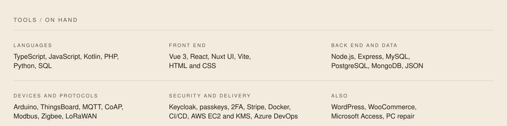

<picture>
  <source media="(prefers-color-scheme: dark)" srcset="assets/masthead-dark.svg">
  
</picture>

I build whole systems: the schema, the API, the interface, the deployment, and the
conversation with the person who has to use it.

I came to software through eight years repairing PCs in a shop in Woori Yallock, then a
stretch at the Powelltown sawmill. Now I lead development of an online tax return app at
CTRL Accounting, finish a computer science degree at Swinburne, and take on client work
from a horse rug maker in Yarra Junction to an Android pack scanner for the timber yard I
came from.

## What I'm building

| Project | What it is | When |
| :-- | :-- | :-- |
| **[WeekBook](https://dylan-robinson.dev/work/school-lesson-planner)** | Lesson planner for Australian P to 12 teachers, with a read-only portal so parents can see what their child is learning this week. Publishing writes a snapshot, so a lesson edited afterwards never changes what a parent has already seen. Private repository, early build. | 2026 |
| **[PackScanner](https://dylan-robinson.dev/work/packscanner)** | Photograph a pack of timber and the phone finds every board end, reads the stamped length on each and hands the operator a grid to correct. Detection runs on the device through LiteRT and a YOLO11n model, lengths through ML Kit OCR. Kotlin Multiplatform, private repository. | 2026 |
| **[CTRL tax return](https://dylan-robinson.dev/work/ctrl)** | Clients answer plain-English questions and pay in one place; a registered tax agent reviews the return in a separate workspace and lodges it with the ATO. Return contents are encrypted in the browser, and 139 tests cover the tax rules, TFN and ABN checks, encryption and Stripe webhooks. Vue 3, Express 5, MongoDB, Keycloak, AWS KMS. | 2023 to now |
| **[Four Seasons Horse Rugs](https://new.fourseasonshorserugs.com.au/)** | Price builder and catalogue admin for a horse rug maker. The owner edits prices, sales, photos and the announcement herself, with no developer involved. Prices are calculated on the server, every write needs a session and a CSRF token. PHP 8, MySQL, Vue 3. | 2026, live |

## Smaller pieces

- **GrowSpace**: a Vue app for tracking greenhouses and the plants inside them, with Firebase sign-in, a tips forum, weather and reminders, installable as a PWA. [Repository](https://github.com/TheSpicyTacoGuy/GrowSpace)
- **Light sensor monitor**: an Arduino feeding a Raspberry Pi, MariaDB and JSON threshold rules, charted in D3 with Active, Stale and Offline read from the age of the last sample. [Repository](https://github.com/TheSpicyTacoGuy/SWE30011-IoT-Programming-Assignment-2)
- **SmartCity dashboard**: IoT monitoring for an industry client, taking data over MQTT, CoAP, Modbus, Zigbee and LoRaWAN, with an Isolation Forest model flagging anomalies. Team capstone under NDA, so it is described rather than shown.
- **Makofire**: a WooCommerce site for an emergency equipment wholesaler. [makofire.com.au](https://www.makofire.com.au/)
- **Essentials**: issues and pull requests on an open-source Android app, in Kotlin. [sameerasw/essentials](https://github.com/sameerasw/essentials)

<picture>
  <source media="(prefers-color-scheme: dark)" srcset="assets/tools-dark.svg">
  
</picture>

## Elsewhere

[Portfolio](https://dylan-robinson.dev) &nbsp;·&nbsp; [CV as a PDF](https://dylan-robinson.dev/cv/dylan-robinson-resume.pdf) &nbsp;·&nbsp; [LinkedIn](https://www.linkedin.com/in/dylan-robinson-415171184/) &nbsp;·&nbsp; [hey@dylan-robinson.dev](mailto:hey@dylan-robinson.dev?subject=Software%20developer%20role%20enquiry)

**Open to full-time software roles, Melbourne or remote.** Unrestricted Australian work rights.

The work above is real and specific. Private repositories are labelled private, and I am happy to walk through that code in an interview.
